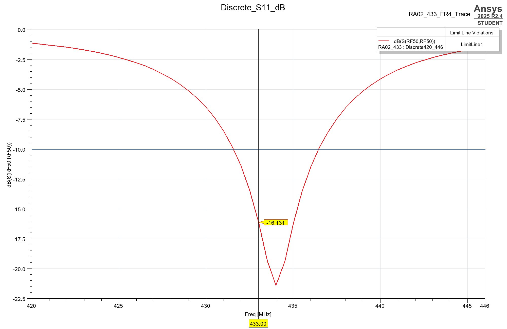

# LoRa PCB antennas and HFSS engineering

## Current design: RA-02 at 433 MHz

The new [433 MHz FR4 antenna design](designs/ra02_433/README.md) is a **120 × 65 mm printed U-bent monopole with a 4.3 nH series / 20 pF shunt matching network**. Native HFSS Student 2025.2.4 discrete verification gives:

| Quantity at 433 MHz | Simulated result |
|---|---:|
| S11, 50 Ω reference | **−16.13 dB** — passes the ≤−10 dB target |
| Input impedance | 49.20 + j15.66 Ω |
| VSWR | 1.37 |
| Reflected power | 2.44% |
| Radiation efficiency | 50.98% |
| Total efficiency | 49.74% |
| Peak realized gain | −1.34 dBi |

Includes **Gerber/drill/DXF/SVG artwork, BOM, native HFSS graphs, Smith chart, gain pattern, current phase animation, complex S11 CSV and the solved project archive**. The matching network is required; the bare trace is not 50 Ω. These are simulated results for the stated stackup and component loss models, not VNA measurements of the complete Raven carrier.



Use `scripts/design_ra02_433.py` to build the current design, `scripts/tune_ra02_433.py` for discrete verification, and `scripts/export_ra02_433_results.py` for native image exports. See the [design folder](designs/ra02_433/README.md) for exact dimensions, assumptions and connection details.

## Earlier 868 / 915 MHz engineering blueprint

A practical import, modeling, matching, automation, and visualization package for an **HFSS 3D Driven Modal** antenna model. Includes native **IronPython 2.7** automation, a runnable illustrative geometry, a protected imported-model workflow, and CPython tools for feedline estimates and publication-quality S11/Smith plots.

## Read this before using the Raven board

The source is [Stavyansh/PCB-Design/lora_module_v1](https://github.com/Stavyansh/PCB-Design/tree/1a9fc4166bf9c25f6e9df71fcfc9cf6936299828/lora_module_v1), inspected at commit `1a9fc4166bf9c25f6e9df71fcfc9cf6936299828` on 2026-10-25. It contains one README and four images. It does **not** contain `.PcbDoc`, Gerber, drill, ODB++, EDB, stackup, or an HFSS model. The README describes a roughly 120 × 65 mm carrier with an **RA-02 / SX1278 at 433 MHz**. Its screenshot shows the module footprint; it does not establish a dimensioned host-board antenna or a controlled-impedance RF launch.

**RA-02 is specified for 410–525 MHz.** Its antenna match cannot convert it into an 868/915 MHz radio. Use a module with the correct band-specific RF front end and verify its footprint, RF connector/pad, and grounding against its manufacturer documentation. The [Ai-Thinker RA-02 specification](https://docs.ai-thinker.com/en/Ra-02/) and [Semtech SX1278 page](https://www.semtech.com/products/wireless-rf/lora-connect/sx1278) establish this limitation. If the antenna connects directly to the module's I-PEX connector, model that actual connector/cable/antenna arrangement; there may be no carrier-board RF feed to optimize.

This package implements the requested **868/915 MHz design workflow for a compatible revision**. It does not claim to reconstruct the source layout or demonstrate a measured/simulated −10 dB result. No original project assets are redistributed.

## Quick start

1. Read [the engineering blueprint](docs/ENGINEERING_BLUEPRINT.md), especially the import acceptance checklist and port reference plane.
2. With AEDT installed, use **Tools > Run Script** and select `scripts/hfss_automation.py`. The default JSON builds an illustrative printed monopole in a new project, configures the solver, and validates it. It does not launch a solve. The generated file is `build/lora_demo.aedt`; rename/remove that generated output before a second run, or choose a new output path.
3. For the real board, prepare a clean HFSS 3D model and follow [configuration and execution](docs/AUTOMATION.md). Set `mode` to `imported`, populate paths/port coordinates/physically connected variables, and complete its explicit geometry confirmations.
4. Solve and inspect the nominal design first. Then enable optimization in a fresh generation, or run the already-created Optimetrics setup from its context menu. Follow [the optimization workflow](docs/OPTIMIZATION.md).
5. Follow [visualization recipes](docs/VISUALIZATIONS.md) for gain overlays and current animation. Export real/imaginary S11 and render polished plots:

```powershell
python -m venv .venv
.\.venv\Scripts\python -m pip install -r requirements.txt
.\.venv\Scripts\python scripts\postprocess_s11.py build\s11_ri.csv --bands 902:928
# If simultaneous coverage is required:
.\.venv\Scripts\python scripts\postprocess_s11.py build\s11_ri.csv --bands 863:870 902:928
```

## What is configured

| Item | Default |
|---|---|
| Solver | HFSS 3D, Driven Modal, one 50 Ω lumped port |
| Adaptive mesh | 915 MHz; ΔS ≤ 0.01; ≥3 passes; 2 converged passes; maximum 20 |
| S-parameter sweep | Interpolating, 800–1000 MHz, 1 MHz output spacing |
| Saved fields | Separate discrete solves at 868 and 915 MHz |
| Radiation region | Air; λ0/4 at 915 MHz = 81.9105 mm plus 16 mm geometry growth allowance on every side |
| Far-field sphere | Full sphere, 2° theta/phi increments |
| Optimization | Quasi Newton, ≤50 iterations, dB(S11) ≤ −10 across 902–928 MHz by default |
| Example variable | `ant_len`, 45–75 mm, bound to the demo radiator solid |

800–1000 MHz has a mathematical midpoint of **900 MHz**. Here **915 MHz is the adaptive solution frequency**, as requested; it is not the center of that sweep interval. Interpolating sweep samples do not each receive independent adaptive meshing.

## Files and verification status

- `scripts/hfss_automation.py`: native AEDT API calls; no remote desktop or GUI control.
- `config/hfss_config.json`: demo/imported selection, port, goals, variable bounds, solve flags.
- `scripts/run_hfss.ps1`: optional local AEDT script launcher.
- `scripts/microstrip.py`: stackup-dependent first estimate of 50 Ω width.
- `scripts/postprocess_s11.py`: real HFSS CSV to 300 dpi PNG + vector SVG, plus sampled-band acceptance.
- `tests/test_tools.py`: config, array-contract mock, arithmetic, CSV and acceptance tests.
- `docs/SOURCES.md`: official vendor references and version notes.

Authoring validation is recorded in [VALIDATION.md](docs/VALIDATION.md). The package was exercised through the installed **Ansys Electronics Desktop Student 2025.2.4** using local non-graphical scripting. The demonstration passed model validation, completed its adaptive solution and sweeps, and exported the requested reports. **The actual Raven PCB remains unmodeled because its editable geometry/stackup are absent.** Native API arrays target the documented AEDT 2024 R2–2025 R2 interface; record the affected command in your installed release if its API differs.

The genuine demonstration baseline data and plot are in [examples](examples/README.md). At `ant_len=60mm`, S11 is about **−3.65 dB at 868 MHz** and **−6.24 dB at 915 MHz**. This baseline does **not** satisfy the target match. It verifies the execution and reporting workflow and provides a starting point for tuning.

The [complete local HFSS run archive](results/README.md) includes the solved native projects, full solution folders/saved fields, bounded optimization outputs, plots and diagnostic attempts. The archive has a file/hash manifest. Rendered 3D gain-overlay images and current-animation exports have not been generated.

## Acceptance evidence to retain

Keep the exact PCB export, stackup/material data, HFSS version, port plane, solved project, ΔS convergence, mesh statistics, discrete S11 check, efficiency/realized gain, air-boundary sensitivity study, and VNA correlation. **S11 ≤ −10 dB means reflected power ≤10%, VSWR ≤1.925, and mismatch loss ≤0.458 dB; it does not establish radiation efficiency.**
