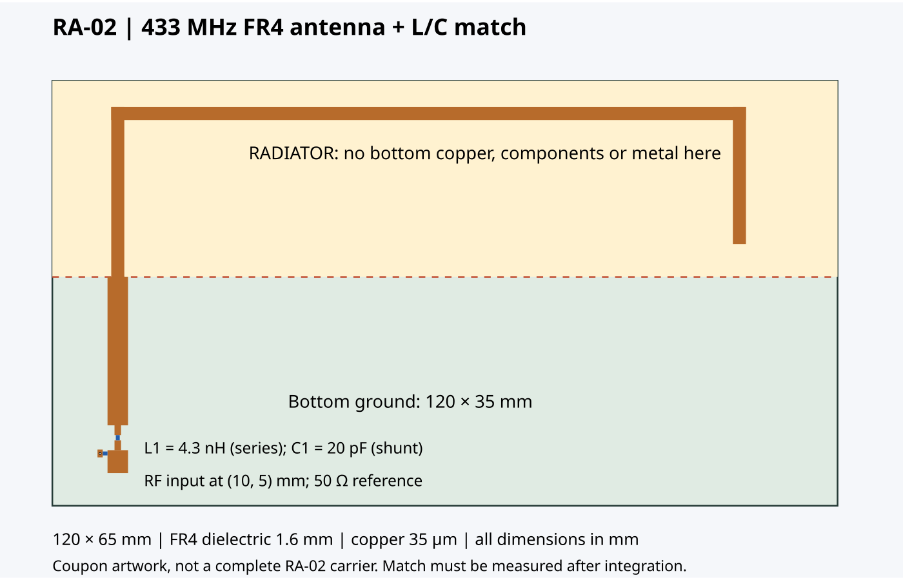
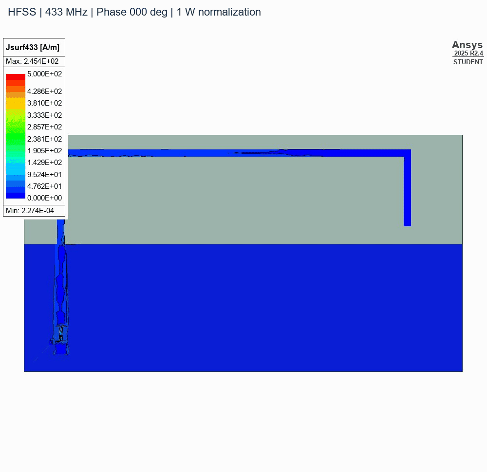

# RA-02 433 MHz FR4 PCB trace antenna

This is a **120 × 65 mm two-layer antenna coupon** for a 50 Ω RA-02 RF interface. It uses a U-bent printed monopole, a bottom ground plane, and a two-component L matching network. The matching network is part of the design: **the bare copper trace is not a 50 Ω antenna**.

The acceptance result is calculated from a **native HFSS discrete solve at exactly 433 MHz**, referenced to 50 Ω. See `verification_433.json` for S11, complex impedance, VSWR and reflected power. The original Raven carrier screenshots were not used as metrology, and this coupon is not a reconstruction of that carrier.

| Final result at 433 MHz | Value |
|---|---:|
| S11 | **−16.1305 dB** |
| Input impedance | **49.2002 + j15.6591 Ω** |
| VSWR | 1.3700 |
| Reflected power | 2.4375% |
| Radiation efficiency | 50.9785% |
| Total efficiency | 49.7358% |
| Peak realized gain | −1.3417 dBi |




## Physical geometry

Coordinates are in mm, with (0,0) at the lower-left board corner as viewed from the top.

| Feature | Exact modeled geometry |
|---|---|
| Board | X = 0–120, Y = 0–65 |
| FR4 dielectric | Z = 0–1.6; εr = 4.3; tanδ = 0.018 |
| Top copper | Z = 1.6–1.635, 35 µm copper |
| Bottom ground copper | X = 0–120, Y = 0–35, Z = −0.035–0 |
| RF feed width | 3.1367; includes the actual matching gaps and pad transitions |
| Antenna trace width | 2.0 |
| Antenna centerline | (10,35) → (10,60) → (105,60) → (105,40) |
| Nominal radiating path | 140 mm along the centerline, excluding the ground-backed feed |
| Ground keepout | No bottom copper above Y = 35; no components or nearby metal in the radiator area |
| L1 electrical gap | Y = 10–10.8, X = 9.5–10.5 |
| C1 ground land | X = 6.9–7.7, Y = 7.4–8.6 |
| C1 electrical gap | X = 7.7–8.43165, Y = 7.5–8.5 |
| Ground via | Center (7.3,8), finished hole Ø0.30, copper barrel OD Ø0.35, radial plating 25 µm |
| RF reference plane | Y = 5, signal centered X = 10, integration from bottom ground to top feed |

The antenna copper comprises overlapping filled rectangles, so bends have square corners and the exact end edges extend by the 1 mm half-width where shown in `artwork/geometry_rectangles.json`. Use that artwork rather than approximating the path with arbitrary rounded routing.

## Required matching network

```text
RA-02 50 Ω RF interface ──o──── L1 ──── printed antenna
                         |
                         C1
                         |
                    plated via → GND
```

Final L1/C1 values are recorded in `final_parameters.json` and `artwork/BOM.csv`. The HFSS model includes **L1 series resistance 0.25 Ω**, **C1 ESR 0.08 Ω and ESL 0.3 nH**, the copper pad transitions, and the plated ground via. These are stated equivalent-circuit assumptions, not a measured vendor S-parameter model. Select RF parts whose impedance/Q/SRF support those assumptions at 433 MHz, and check their manufacturer models before a production release.

Populate **L1 = 4.3 nH** and **C1 = 20 pF** for the final simulated design. Use an RF inductor and a C0G/NP0 capacitor. Reserve adjacent values for VNA tuning after integration.

The custom lands can accommodate small RF SMD parts, but are not a universal library footprint. Check the selected package's drawing and assembly tolerances. L1 spans the 0.8 mm signal gap. C1 bridges the RF strip edge to the ground land. The ground via is in the C1 ground land; address via-in-pad solder wicking with the fabricator/assembler. Do not replace L1 with 0 Ω or omit C1 and expect the reported match.

## Fabrication and connection

`artwork/` contains top/bottom copper Gerber RS-274X files, top/bottom mask openings, a board profile, plated drill, DXF, annotated SVG and BOM. Units are **mm**, common origin. Mask files deliberately open the entire coupon: **the modeled antenna/feed have no solder mask**. Specify the dielectric distance and material properties above; a fabricator's generic “1.6 mm FR4” stackup may not reproduce them. The total modeled copper-to-copper thickness is 1.67 mm including both copper layers.

This is an antenna subsection/coupon, not a full radio carrier with connector, power and logic. Connect the RA-02's documented 50 Ω RF antenna interface through a short characterized 50 Ω launch/coax to the reference plane. The simulation uses an ideal lumped launch at that plane; an actual connector, cable shield, full host PCB, enclosure and mounting hardware can alter the result. Integrate those into the EM model and perform VNA tuning on the assembled product.

## Simulation and evidence

- Native HFSS Student 2025.2.4, Modal Network, 50 Ω lumped port.
- Adaptive solve at 433 MHz, ΔS target 0.01, two consecutive converged passes, 10% refinement for the final run.
- Radiation air padding 220 mm on every side, exceeding λ0/4 at 350 MHz.
- Wide interpolating sweep 350–550 MHz and separate **53-point discrete sweep 420–446 MHz at 0.5 MHz spacing**.
- The discrete frequencies are separate frequency solutions on the 433 MHz adaptive mesh; they are not independently adapted meshes.
- Full fields saved at 433 MHz with `SaveFields=True`, `SaveRadFields=False`.
- Finite-conductivity copper and lossy FR4; matching component loss assumptions as above.

`hfss_exports/` contains **direct native HFSS image exports**, underlying CSV data, gain/current outputs, convergence data and export logs. The current images use the simulator's 1 W source normalization, not an assertion of RA-02 output power. The GIF is encoded from the native phase frames, with fixed color limits; it represents a steady-state 433 MHz carrier (period about 2.31 ns), not a LoRa packet waveform.

The final adaptive solution converged in **13 passes** with **19,719 solved elements** and final max ΔS **0.0033156**; its final two passes were below 0.01. The 53-point independent discrete sweep passed at 433 MHz. Samples from 432–436 MHz met −10 dB at the 0.5 MHz grid points; this is sampled nominal coverage, not a tolerance-qualified continuous band claim. A separate stricter ΔS=0.005 trial exceeded the Student mesh limit and was not used for acceptance.

Extract `RA02_433_solved_project.zip` preserving the `.aedt` file and matching `.aedtresults` directory together to open the solved model. `RA02_433_gerbers.zip` is the fabrication artwork bundle. Hash manifests accompany the solved-project archive.



The nominal S11 result is simulation evidence under these assumptions. Verify the final assembly with a calibrated VNA at the same reference plane. Dk, etching, component tolerances, mask, connector and enclosure changes require retuning. S11 by itself does not establish radiation efficiency; use the included radiation data as well.

## Reproduce

From the repository root, run the builder in AEDT's native IronPython engine (`Tools > Run Script`), or launch it locally with `ansysedtsv.exe -ng -RunScriptAndExit`. Choose a new `RA433_OUTPUT` path to avoid overwriting another run. `design_ra02_433.py` builds the geometry and nominal solution; `tune_ra02_433.py` performs the discrete verification; `export_ra02_433_results.py` exports native plots from the solved final project.

```powershell
python scripts\check_ra02_433.py designs\ra02_433\hfss_exports\Discrete_S11_RI.csv --output designs\ra02_433\verification_433.json
python scripts\export_ra02_433_layout.py designs\ra02_433\final_parameters.json designs\ra02_433\artwork
```

The old 868/915 MHz workflow remains elsewhere in the repository as prior reference. Use this folder for the RA-02 433 MHz design.
