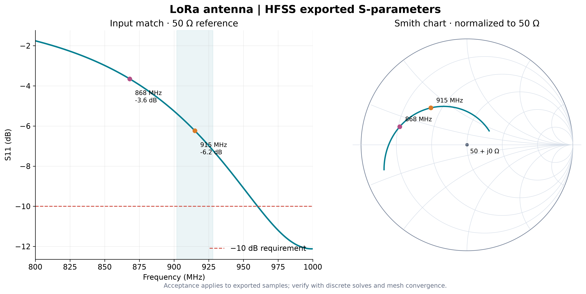

# Genuine HFSS demonstration baseline

These files come from the package's illustrative monopole, solved locally in **Ansys Electronics Desktop Student 2025.2.4** on 2026-10-25. They do not describe the Raven PCB.

`lora_demo_prepared.aedt` is the final prepared demonstration model with the corrected native Optimetrics variable settings. It includes geometry and solver setup; solution caches are excluded, so solve it locally to populate results. The CSV and plot below preserve the earlier nominal baseline solve with the same physical geometry.

- `demo_baseline_s11_ri.csv`: real/imaginary S11, 50 Ω reference, 800–1000 MHz interpolating sweep at 1 MHz output spacing, `ant_len=60mm`.
- `demo_baseline_s11_smith.png` and `.svg`: generated from that CSV by the delivered plotting script.
- `demo_baseline_convergence.txt`: native adaptive convergence evidence at 915 MHz.

The adaptive solve converged in **14 passes**, with **14,014 solved elements** at the final pass and **max ΔS = 0.0072788**; the two final passes met the 0.01 threshold. The interpolating sweep also reported convergence. This is a nominal workflow test, not a completed mesh/airbox/tolerance or measurement correlation study.

Baseline S11 at 868 MHz is **−3.6488 dB**; at 915 MHz, **−6.2368 dB**. The worst sample over 902–928 MHz is **−5.379 dB**, so the band fails the −10 dB requirement. The lowest sampled S11 over 800–1000 MHz is approximately −12.12 dB at 999 MHz. Tuning is necessary to move and broaden the match.

